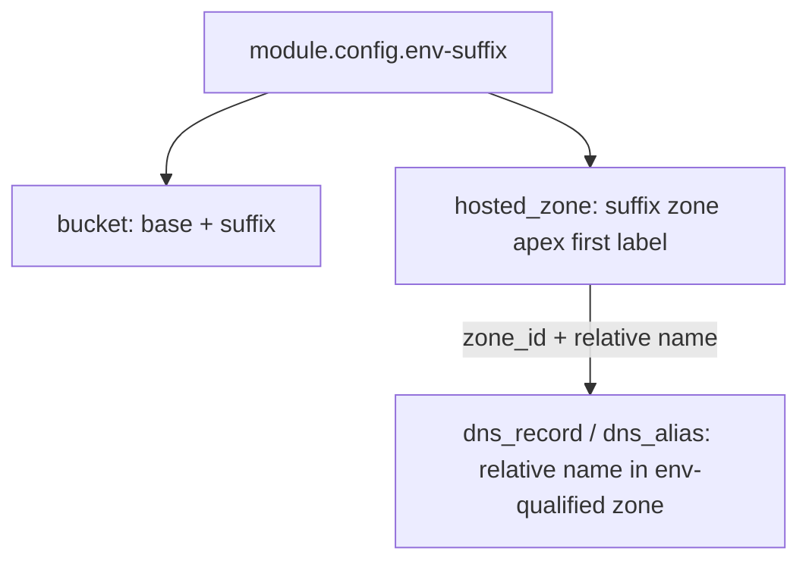

# Apply env-suffix to DNS modules (bucket-style)

**Date:** 2026-07-03  
**Generated by:** Composer

## Overview

Apply `env-suffix` inside DNS modules the same way the bucket module does: callers pass base names, modules produce env-distinct AWS-visible names in nonprod, and prod remains a no-op via `module.config.env-suffix = ""`.

## Implementation todos

- [ ] Add `env_qualified_name` local to `hosted_zone`; use in zone name; add `qualified_name` output; require `env-suffix`
- [ ] Add `env_qualified_name` local to `dns_record` (relative names pass through, FQDN gets first-label suffix); require `env-suffix`
- [ ] Same naming local for `dns_alias` `name` field only (not alias target); require `env-suffix`
- [ ] Remove misleading `env-suffix` defaults; optionally add `repo`/tags to `dns_record` and `dns_alias`
- [ ] Run `tofu validate` on all three DNS modules
- [ ] Revise `deps-examples/DNS-EXAMPLES-PLAN.md` and example `.tf` files to pass base names only (separate repo follow-up)

## Current state

The [`config`](terraform/modules/config/config.tf) module already defines the contract:

- **nonprod:** `env-suffix = "-nonprod"` (or `"-{env}"`)
- **prod:** `env-suffix = ""` (no-op)

The [`bucket`](terraform/modules/bucket/bucket.tf) module is the reference implementation — it appends suffix to the AWS-visible identifier:

```hcl
bucket = "${var.attributes.bucket}${var.env-suffix}"
```

Callers pass a base name only (see `deps-examples/terraform/nonprod/example-bucket.tf`):

```hcl
attributes = { bucket = "deps-examples-bucket" }
env-suffix = module.config.env-suffix
```

All three DNS modules **declare** `env-suffix` but **never use it**:

| Module | File | AWS-visible field | Current value |
|--------|------|-------------------|---------------|
| `hosted_zone` | [`hosted_zone.tf`](terraform/modules/hosted_zone/hosted_zone.tf) | Zone domain name | `var.name` raw |
| `dns_record` | [`dns_record.tf`](terraform/modules/dns_record/dns_record.tf) | Record name / FQDN | `var.name` raw |
| `dns_alias` | [`dns_alias.tf`](terraform/modules/dns_alias/dns_alias.tf) | Record name / FQDN | `var.name` raw |

DNS modules also have a misleading default (`default = "dev"`) on `env-suffix` while [`config`](terraform/modules/config/config.tf) produces `"-dev"` — bucket correctly requires the caller to pass the config output.

---

## Recommended approach

Given two goals — **AWS console discoverability** and **developer convenience**, with **prod as a no-op** — use a two-tier pattern:



### 1. `hosted_zone` — suffix the zone apex (like bucket)

Transform multi-label zone names by appending `env-suffix` to the **first label**:

| Caller passes | nonprod result | prod result |
|---------------|----------------|-------------|
| `deps-examples.example.com` | `deps-examples-nonprod.example.com` | `deps-examples.example.com` |
| `example.com` | `example-nonprod.com` | `example.com` |

Shared local (add to each DNS module, or a tiny shared `locals.tf` if you prefer DRY):

```hcl
locals {
  name_parts = split(".", var.name)

  env_qualified_name = (
    var.env-suffix != "" && length(local.name_parts) > 1
    ? "${local.name_parts[0]}${var.env-suffix}.${join(".", slice(local.name_parts, 1, length(local.name_parts)))}"
    : var.name
  )
}
```

Use `local.env_qualified_name` in `aws_route53_zone.zone.name`.

Add an output `qualified_name` so callers can reference the actual zone apex without recomputing.

### 2. `dns_record` and `dns_alias` — relative names, env via zone

**Do not suffix relative record names.** When the hosted zone is already env-qualified, a relative name like `verify` or `www` automatically produces an env-distinct FQDN in the AWS console:

- nonprod: `verify.deps-examples-nonprod.example.com`
- prod: `verify.deps-examples.example.com`

This mirrors bucket ergonomics: callers pass the same HCL in prod and nonprod; only `module.config` differs.

Keep `env-suffix` as a required input on these modules for API consistency with bucket/hosted_zone, but **only apply it when `name` is a multi-label FQDN** (no dots → use as-is). That covers edge cases where a record is created outside an env-qualified zone without forcing double-suffixing in the common path.

**Do not suffix `var.value` in `dns_alias`** — that is the alias target (CloudFront, S3, ALB DNS name), which is AWS-managed and not ours to rename.

### 3. Align variable contracts with bucket

In all three DNS [`main.tf`](terraform/modules/hosted_zone/main.tf) files:

- Remove `default = "dev"` from `env-suffix` — make it **required**, like bucket
- Optionally add `repo` + `Environment` tags to `dns_record` and `dns_alias` for console parity with bucket/hosted_zone (hosted_zone already tags; record modules currently have no tags)

---

## Files to change

| File | Change |
|------|--------|
| [`terraform/modules/hosted_zone/hosted_zone.tf`](terraform/modules/hosted_zone/hosted_zone.tf) | Add `locals`, set `name = local.env_qualified_name`, add `qualified_name` output |
| [`terraform/modules/hosted_zone/main.tf`](terraform/modules/hosted_zone/main.tf) | Remove `env-suffix` default |
| [`terraform/modules/dns_record/dns_record.tf`](terraform/modules/dns_record/dns_record.tf) | Add `locals`, set `name = local.env_qualified_name` (relative names pass through) |
| [`terraform/modules/dns_record/main.tf`](terraform/modules/dns_record/main.tf) | Remove `env-suffix` default; optionally add `repo` variable + tags |
| [`terraform/modules/dns_alias/dns_alias.tf`](terraform/modules/dns_alias/dns_alias.tf) | Same as dns_record for `name` only |
| [`terraform/modules/dns_alias/main.tf`](terraform/modules/dns_alias/main.tf) | Remove `env-suffix` default; optionally add `repo` variable + tags |

### Minor bucket follow-up (optional, same PR or separate)

[`terraform/modules/bucket/bucket.tf`](terraform/modules/bucket/bucket.tf) — `bucket_prefix` does not get `env-suffix`. If that code path is ever used, apply the same suffix for consistency.

---

## Caller impact (after module change)

Update `deps-examples/DNS-EXAMPLES-PLAN.md` and future example `.tf` files to pass **base names only**:

```hcl
# hosted_zone — base zone name, module suffixes
module "example_hosted_zone" {
  name       = "deps-examples.example.com"
  env-suffix = module.config.env-suffix
  env        = module.config.env
  repo       = module.config.repo
}

# dns_record — relative name, env appears via zone
module "example_dns_record" {
  name       = "verify"
  zone_id    = module.example_hosted_zone.id
  ...
}

# dns_alias — relative name
module "example_dns_alias" {
  name    = "www"
  zone_id = module.example_hosted_zone.id
  ...
}
```

**Breaking change:** Any existing caller that manually concatenates `env-suffix` into `name` (as the plan doc currently recommends) will double-suffix after this change. Grep consumer repos for `${module.config.env-suffix}` inside DNS `name` arguments and remove manual concatenation.

---

## Verification

No automated tests exist in `deps`. Validate with:

```bash
cd terraform/modules/hosted_zone && tofu init -backend=false && tofu validate
# repeat for dns_record, dns_alias
```

After publishing / pointing deps-examples at the updated modules:

```bash
cd deps-examples/terraform/nonprod && tofu plan
# Expect: deps-examples-nonprod.example.com, verify.deps-examples-nonprod.example.com, www.deps-examples-nonprod.example.com

cd deps-examples/terraform/prod && tofu plan
# Expect: no suffix — deps-examples.example.com, verify.deps-examples.example.com, etc.
```

Confirm prod plans show **no resource replacement** for already-deployed resources that were manually suffixed at the call site (may require a one-time state migration or destroy/recreate in examples only).

---

## Why this over alternatives

| Approach | Console visibility | Dev convenience | Prod no-op | Risk |
|----------|-------------------|-----------------|------------|------|
| **Relative names + env-qualified zone (recommended)** | FQDN shows env via zone | Same HCL in prod/nonprod | Automatic via `""` suffix | Low — matches bucket mental model |
| First-label suffix on every record FQDN | Yes | Callers pass full FQDNs | Yes | `verify.deps-examples.example.com` becomes `verify-nonprod.deps-examples.example.com` — wrong vs intended plan |
| Manual suffix at call site (status quo) | Yes | Error-prone, inconsistent with bucket | Yes | Easy to forget suffix on one record |

The recommended approach keeps **one place** (hosted zone) responsible for env disambiguation in DNS, just as bucket owns env disambiguation for S3 — while record modules stay simple and prod stays untouched.
